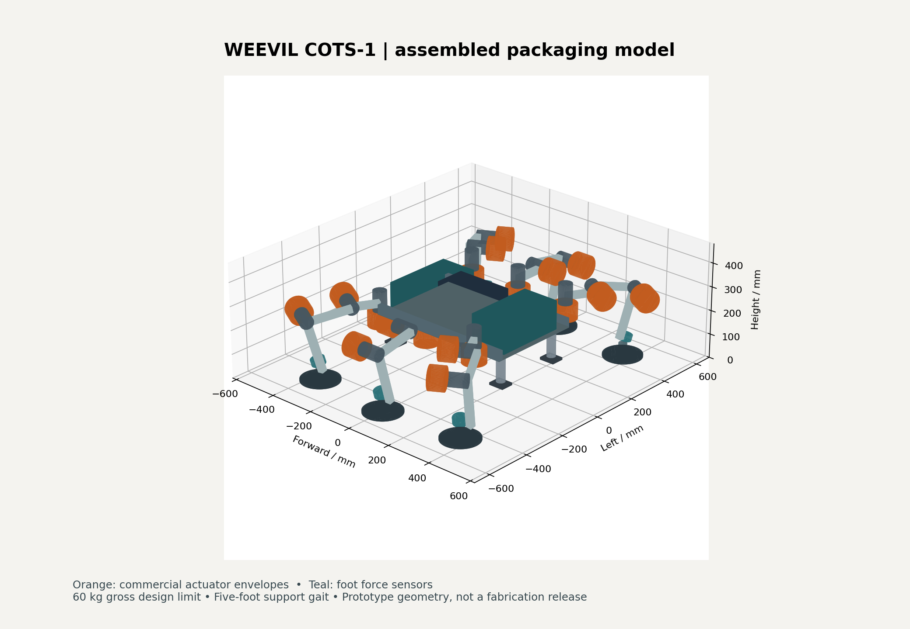

# Weevil COTS-1: instrumented ground prototype

**Design baseline: 60 kg maximum gross mass, six three-joint legs, five feet supporting during a step.** This is an engineering prototype for developing the Lunar Weevil's locomotion and contact sensing. It is analytically screened, not hardware validated, fabrication released, or flight qualified. It does not inherit a validated soil model from the earlier screw-foot concept.

The commercial assemblies are selected; the interfaces, operating envelope and acceptance tests are defined below. Custom bearing cartridges, torque hubs, clevises, gimbals, harnesses and the landing guides still need detailed drawings and physical verification. The STEP file is a packaging model, not a complete set of parts to send to a machine shop.

**Tranche 02 test update:** the additional 12,528 nominal/sensitivity/interpolation cases pass their sampled constraints, but 2,921 of 5,400 support-loss cases are infeasible under the configured limits. The expanded CAD inventory finds 70 unresolved overlapping pairs. See [the full test report](../../verification/cots/tranche_02/README.md); fabrication and unrestrained walking remain blocked.



## What changes

- Use independent yaw, hip-pitch and knee joints for controllable foot placement. The original coupled screw/twist arrangement remains a separate research experiment. Ordinary walking receives no anchoring or actuator-preload traction credit.
- Measure all six components of foot load. Use feedback to distribute loads and detect slip, overload or missing contact. The allocator included here is an offline reference, not a deployed motor controller.
- Support joint loads with independent bearing cartridges. The motor's undocumented output moment capacity is not a structural assumption.
- Start with a slow five-foot support gait and an overhead catch. Park on guided landing shoes before releasing torque; the gearbox is not treated as a brake.
- Separate geometry, force equilibrium, mass, power and collision checks so a passing calculation cannot silently become a hardware or lunar-performance claim.

## Selected commercial assemblies

| Subsystem | Selection | Quantity | Design use |
|---|---|---:|---|
| Joint drive | CubeMars AK80-64 KV80, matching **48 V driver** | 18 | Catalog 48 Nm rated; software torque cap 43.2 Nm; speed cap 0.30 rad/s |
| Joint support | SKF 6204-2RSH, 20 × 47 × 14 mm | 36 | Two bearings per joint, 60 mm center spacing |
| Foot instrumentation | ATI Mini45 IP65/IP68, SI-580-20 calibration, matched NETBA system | 6 | Resolve actual contact wrench, rather than infer grip from motor current |
| Motor communication | PEAK PCAN-USB X6 **IPEH-004063** | 1 | Six isolated CAN channels, one per leg; external 12 V supply |
| Battery | Bioenno BLF-3620A, 36 V / 20 Ah | 1 | 720 Wh nominal; 16 A design bus budget; 34 V operating cutoff |
| Bench supply | MEAN WELL RSP-1500-36 | 1, offboard | Restrained tests; set current limit to the battery profile |
| Regeneration | ODrive Regen Clamp with heatspreader + TE HSC3004R7J | 1 each | Dissipate braking energy independently of battery charge acceptance |
| Auxiliary power | MEAN WELL RSD-100C-12 + Pololu D24V90F5 | 1 each | 12 V equipment and 5 V computing |
| Ground perception | Raspberry Pi 5, OAK-D S2, Moxa EDS-208A | 1 each | Supervisory planning, stereo experiments and force-sensor networking |
| Landing absorption | ACE MC600EUM, independently guided | 4 | Energy-screened catch shoes; not demonstrated fall protection |

The [BOM](bom.csv) gives full-rover and single-leg-rig quantities, mass allocations, source IDs and unresolved procurement details. [sources.json](sources.json) links primary manufacturer documentation and records reference hashes. Off-the-shelf does not mean space-qualified or currently in stock. Obtain matching revisions and firm quotes before purchasing.

## Geometry and operating profile

All analysis lengths are metres; CAD lengths are millimetres. The body frame is x forward, y left, z up. The URDF base is at the hip plane, 300 mm above nominal terrain; its deck visual is indicative.

| Parameter | Baseline |
|---|---:|
| Chassis equipment envelope | 620 × 400 × 160 mm |
| Hip positions | x = +240, 0, −240 mm; y = ±260 mm |
| Coxa / femur / tibia | 120 / 180 / 220 mm |
| Nominal radial reach from yaw axis | 240 mm |
| Hip / foot-gimbal pivot height | 300 / 55 mm |
| Pad diameter | 160 mm |
| Pad passive tilt requirement | ±35° in two axes |
| Foot sweep / lift | 60 / 40 mm |
| Phase / force-transfer dwell | 5.0 / 0.5 seconds |
| Mean initial body speed | 2.18 mm/s |
| Operational progression | Restrained flat-floor tests, then ≤5°; 10° remains an analytical screening boundary |

A phase advances the body 12 mm; a full six-phase cycle advances 72 mm. The 60 mm foot sweep is not the world-frame stride. Quintic time scaling gives zero endpoint velocity and acceleration. Transfer load with all six feet down before lifting the next leg. The static screen omits the transition controller and dynamics.

At 10°, the calculated joint bound is close to the software cap. Do not infer additional payload, disturbance or slope capacity. Commission at measured mass and COM, then rerun the analysis for any geometry, payload, speed or control change.

## Reproducible results

[analysis.json](analysis.json) is generated from the committed configuration and BOM. The screen samples 54 gait poses, four COM corners and nine gravity directions: **1,944 static cases**. Assumptions include Earth gravity, a 1.3 load factor, COM x/y uncertainty ±40/30 mm, COM height 300 mm, and an assumed friction coefficient 0.5.

| Quantity | Calculated result | Criterion |
|---|---:|---:|
| Largest joint torque bound, including link gravity | 42.67 Nm | ≤43.2 Nm |
| Largest foot normal force | 296.29 N | ≤300 N |
| Smallest support-polygon margin | 74.16 mm | ≥40 mm |
| Smallest pad-to-pad horizontal gap | 153.65 mm | ≥20 mm |
| Largest required pad COP offset | 27.50 mm | ≤70 mm |
| Peak sampled joint speed | 0.2685 rad/s | ≤0.30 rad/s |
| Tube yield factor, ideal straight member | 4.25 | ≥2 |
| Shaft yield factor, specified material and notch assumption | 2.15 | ≥2 |
| Bearing static capacity / screened radial reaction | 2.28 | ≥2 |
| CAN utilization, including allowance | 29% per bus | ≤50% |

These are sampled, quasi-static results. They do not prove continuous collision avoidance, gearbox life, actuator holding duration, fatigue, foot compliance or soil behavior. The 1.3 load factor is a sizing allowance, not a dynamic simulation.

The force allocator enforces all three force and all three moment equations, unilateral contact and a conservative inscribed friction pyramid. It minimizes peak utilization subject to joint and foot limits. Internal leg preload cannot increase total ground normal force. Link-gravity torque magnitudes are added conservatively without credit for cancellation. No motor phase-current rating is treated as a battery-current rating.

## Mass, power and cost

The present mass allocation is **56.335 kg**, leaving **3.665 kg** inside the 60 kg gross limit. This reserve covers unresolved mounts, cable details and fabrication growth; it is not committed science payload. Catalog masses and engineering allowances are distinguished in the BOM. Actual weighing and COM measurement are release gates. A lightweight lunar article would require a separate mass redesign.

The battery budget is 16 A, or 544 W at the 34 V cutoff. Auxiliary input allocation is 110 W, leaving 434 W for drive electronics and motors at that point. This is a budget, not a measured holding-power prediction. Using an assumed 80% usable battery energy and keeping a further 72 Wh reserve gives 504 Wh for planning: **121, 75.6 or 60.5 minutes** at measured total mean draws of 250, 400 or 500 W. Availability of that energy above 34 V, including temperature and sag, must be measured.

Manufacturer list prices observed on 2026-10-16 give **$17,818.20 for 18 actuator/driver assemblies**, or **$2,969.70 for three**. Battery-only price was $379.99. These are partial subtotals, not a complete build quote; ATI systems, machining, electrical protection and instrumentation still require quotes. Store availability indicators conflict for the actuator, so stock is unconfirmed. Begin with one restrained three-joint leg to test the architecture before committing to six.

## Files and reproduction

- [Mechanical and electrical interfaces](interfaces.md)
- [Acceptance tests and unresolved release gates](acceptance.md)
- [Design decisions](decisions.md)
- [Packaging STEP](../../cad/cots_v1/rover_packaging.step), [kinematic URDF](../../cad/cots_v1/rover_kinematics.urdf), [CAD check report](../../cad/cots_v1/cad_checks.json)
- Parametric CAD source: `cad/scripts/build_cots_rover.py`; analytical source: `models/cots_rover.py`.

From `weevil-lunar/`:

```sh
python -m pip install -r ../requirements.txt -r ../requirements-dev.txt
python -m models.cots_rover --output design/cots_v1/analysis.json
python -m pytest verification/tests/test_cots_rover.py -q
python -m pip install -r ../requirements-cad.txt
python cad/scripts/build_cots_rover.py --output /tmp/weevil-cots-rebuild
```

Use a new, nonexistent output directory for CAD generation. STEP is AP214, with its actual schema checked on export; no AP242 certification is claimed. Import the STEP into FreeCAD for inspection, or regenerate through CadQuery. It contains dimensioned commercial envelopes rather than redistributed vendor CAD. The URDF has 18 actuated joints and complete foot chains but intentionally lacks validated inertials and collision meshes.

The earlier soil/anchor findings and the project's `DECISION_MEMO.md` gates remain in force. This independent baseline does not turn earlier simulated traction into measured evidence or authorize hardware-validation spend based on the old soil model.
