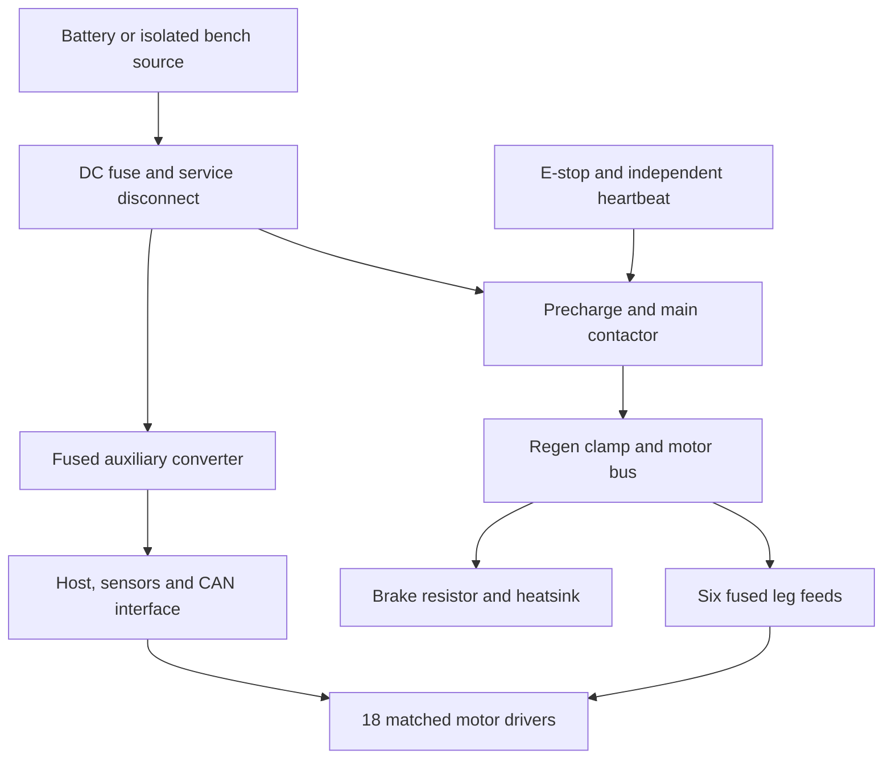

# COTS-1 interface control and implementation requirements

Status: preliminary engineering interfaces. Dimensions below are extracted facts or explicitly identified design requirements. This document is not a fabrication drawing release.

## Mechanical load path

Pad → passive two-axis gimbal → ATI sensor → tibia clevis → supported knee shaft → femur → supported hip-pitch shaft → coxa → supported yaw shaft → chassis. The transducer must remain in the complete foot load path; a boot, cable or hard stop must not bypass it during measurement. Sensor moments from its offset relative to the gimbal must be transformed into the ankle frame. A gimbal transmits force while allowing the pad to align with the floor; the controller must use the calibrated sensor-to-foot transform.

The chassis budget includes the 3 mm deck and two solid 20 × 40 × 620 mm rails shown in CAD: approximately 4.69 kg of aluminum before restraints. Its 5.0 kg allocation must be checked after mounting details are complete.

Use 25 × 25 × 2 mm tube with certified yield ≥240 MPa. Use 20 mm solid shafts, approximately 100 mm maximum length, from certified quenched-and-tempered steel with yield ≥900 MPa. The 0.25 kg shaft allocation includes full solid stock, not an unmodeled hollow shaft. Obtain material certificates; an alloy name alone does not establish heat-treatment strength.

Each joint has two SKF 6204-2RSH bearings at 60 mm center spacing. The carrier envelope is Ø56 × 84 mm. Detailed retention, press/sliding fits, bearing shoulders, preload/clearance, seals, fastener joints and shaft fatigue still need drawings and review. The static shaft screen uses a 400 mm load arm, whole-leg gravity and stress-concentration factor 2. The bearing screen is a radial static check only; combined axial load, bearing arrangement and life must be checked before fabrication. A short 20 mm hub eccentricity would dangerously omit yaw overturning. The sampled geometry plus a 40 mm mounting-offset allowance reaches 394.6 mm; changing that packaging invalidates the screen.

The motor drives the shaft through a separately retained torque hub. Do not route cantilever loads through the actuator's output bearing until the manufacturer supplies allowable radial, axial and moment loads. A compliant or correctly aligned torque coupling must avoid overconstraining the commercial bearing and the new bearing pair. Coupling misalignment and adapter compliance are unresolved fabrication details.

### CubeMars interface facts

Source: `CM-DRAWING`, visually checked manufacturer drawing.

| Feature | Manufacturer dimension | Design consequence |
|---|---|---|
| Overall motor envelope | Ø98 × 61.9 mm | Modeled as a cylinder; connector and cable space require additional envelopes |
| Front fixed housing pattern | 8 × M3, PCD89, 10 mm thread depth | Fixed-side coupon uses Ø3.4 clearance holes |
| Rear fixed housing pattern | 8 × M3, PCD85, 7 mm thread depth | Different interface; do not substitute for front |
| Rotor mounting | 6 × M4, PCD28, 8 mm thread depth | Coupon uses Ø4.5 clearance holes at 30° + 60° increments |
| Rotor locating holes | Two Ø3 +0.05, depth 3 mm, at ±14 mm | Torque load sharing and pin bearing stress require proof |
| Rotor pilot bore | Ø21 +0.02, depth 4.5 mm | Coupon pilot Ø20.98 × 4.2 mm; verify fit and print/machining tolerance |

The output fit coupon has a Ø50 × 8 mm flange and Ø20.1 central clearance. Its thin pilot wall and plain through-bore do **not** form a released load-bearing shaft connection. The stator coupon is 116 × 116 × 6 mm with Ø72 center clearance. Both coupons are interface gauges; they are not present in the packaging model as finished carriers. Check bolt protrusion against thread depth with washers, locking method and actual mating thickness. Fastener grade, tightening torque and retention require the supplier's approval; no unspecified bolt torque is supplied here.

ATI Mini45 mounting is governed by drawing `9230-05-1443`, not the motor's pattern. Reserve connector access and strain relief. Confirm the ordered sensor/plate/cable variant, combined-load envelope and calibrated coordinate frame before designing its adapters. Calibration SI-580-20 nominal ranges are 580 N lateral, 1160 N axial and 20 Nm moments; these individual ranges do not define an approved combined-load boundary. At 300 N normal, assumed friction 0.5 and a 28 mm sensor offset, a conservative force-resultant × offset bound is about 9.4 Nm; validate the actual adapter geometry against the combined-load limit.

### Feet and landing shoes

Pads are Ø160 mm, with replaceable tread and a nominal pivot 55 mm above the contact plane. Required COP travel in the screen is at most 27.5 mm versus a 70 mm permitted radius after edge reserve. This assumes a rigid flat contact area and measured adequate friction. Regolith may sink, shear or tilt; broad pads alone do not prove lunar mobility.

The four guided landing shoes have 70 mm initial floor clearance and 25 mm shock travel. A worst-case single absorber accepting the entire 60 kg body's vertical drop including the stroke must dissipate 55.90 J. This is below the MC600EUM's 136 J/cycle catalog rating; effective mass and impact speed also fit its catalog ranges. It does not establish peak frame force, off-center tipping resistance or impact safety. Guide the shoe separately so the damper rod does not take lateral force. Its bare-rod side-load limit is 2°. Park by lowering onto the shoes while retaining their impact stroke; do not leave the dampers continuously supporting the vehicle without a mechanical park stop/bypass designed for that load.

## Electrical architecture

This is a functional diagram, not an approved wiring schematic. The battery and bench supply are mutually exclusive sources; neither is directly paralleled with the other. Specify branch fuses, service disconnects, precharge resistor/relay, connectors and conductors for at least the maximum DC system voltage and actual fault current. AC ratings do not establish DC interrupt capability. Verify battery short-circuit and BMS behavior with the supplier before final fuse coordination. The bench supply can exceed the battery's current capability; enforce the same 16 A operating budget.

The contactor is upstream of the clamp so it does not intentionally disconnect the braking resistor from the motors. Nonetheless, power-loss behavior, controller brownout and the clamp's response with its input disconnected are **unverified**. Do not assume this arrangement prevents collapse or overvoltage on E-stop. The restrained rig test must demonstrate it; otherwise add a separately engineered passive dump path before free-standing operation. First tests use an independent physical catch.

Precharge the measured downstream capacitance before closing the main contactor; select resistor energy and timing from measured capacitance, maximum 43.8 V source and contactor limits. Monitor contactor auxiliary state and bus voltage. Do not guess a precharge resistor from nominal battery current.

### Power and regeneration constraints

- Battery maximum charging voltage is 43.8 V. The clamp's specified maximum turn-on rise of 2.5 V gives a 46.3 V screening level versus 52 V maximum on the selected driver. This 5.7 V arithmetic difference does not bound switching overshoot or wiring inductance.
- Use the exact 48 V driver variant with specified 18–52 V input. Some AK driver revisions are limited to 28 V. Read back and record hardware, firmware and motor model before enabling torque.
- The 4.7 Ω resistor's ±5% tolerance gives about 10.37 A and 480 W instantaneous dissipation at the highest screened voltage. Its 300 W nominal rating is conditional on mounting; pulse suitability and heatsink sizing require manufacturer confirmation and thermal tests.
- At the 34 V cutoff, minimum screened resistor absorption is about 270 W, above the independent 18 × 43.2 Nm × 0.30 rad/s mechanical bound of 233.3 W. The software aggregate limit of 150 W is additional control, not the hardware sizing premise. Keep measured average resistor dissipation ≤100 W until thermal testing establishes another limit.
- The clamp's thermal protection turns it **off**. Monitor temperature independently and park before its trip; a thermal trip is not a benign braking state.
- RSD-100C-12 requires 33.6–62.4 V continuously. Its wider range is specified for only one second. Stop motion and park at 34 V under load, with hysteresis and early prediction from sag; verify the chosen margin experimentally. Upstream auxiliary electronics remain powered during an ordinary motor contactor opening while the source is present.

Allocate at most 110 W battery input for auxiliaries, including conversion losses. Preliminary 12 V output budgets: six Net F/T interfaces 36 W maximum total (manual: 11–25 V, 6 W each), Pi/camera 5 V path 34 W including buck losses, CAN interface 10 W, Ethernet switch 3 W and contactor/monitor 10 W: 93 W against the converter's 100.8 W rating. Confirm exact configured loads and ambient derating. The 5 V buck does not implement USB-C PD: use a correctly engineered power connection, independently powered camera where necessary and the documented Pi USB power configuration. A raw USB-C cable is not evidence of 5 A negotiation.

## Control and fault handling

Use six 1 Mbit/s classical CAN segments with three drivers each. At 250 Hz, two frames per motor per cycle and an allowance of 160 bits/frame, command/feedback utilization is 24%, plus 5% allowance. Two 120 Ω terminators belong at each bus's physical endpoints only; verify built-in resistors and the PCAN jumper configuration. PEAK variant 004063 has isolation; 004062 does not. Power PCAN from the 12 V rail, not from USB alone.

The reference control sequence is:

1. Start in a restrained/parked state; verify source voltage, physical E-stop, temperature, calibration identities and watchdog.
2. Home each leg slowly against an independent switch while supported. A 14-bit single-turn motor encoder is not proof of absolute multi-turn joint position after a power cycle.
3. Confirm six contact wrenches and measured body pose; initialize the force allocator.
4. Transfer load with six contacts, then run one swing while the other five maintain feasible wrenches. Reject a step before lift if required torque, force, support margin or friction limits fail.
5. On loss of an expected support or stale force/position feedback, inhibit advance and latch the fault. Do not automatically hold an infeasible posture, place the swing foot, disable torque or open a contactor. Their physical consequences are unverified. The independent external restraint must support commissioning while a reviewed response is demonstrated. Only a separately checked, dynamically tested recovery trajectory could authorize controlled placement; none currently exists.
6. On host/driver communication loss, an independent heartbeat monitor must trigger the tested park/catch response. Requirements: motor feedback stale at 40 ms, independent heartbeat timeout at 100 ms. These are design requirements, not proven firmware features.

The host is not a safety controller. The current repository addition does not implement motor I/O, homing, hardware watchdog wiring or certified E-stop behavior. Firmware protocol encoding ranges (including ±144 Nm in a manual table) must never override the 43.2 Nm design cap. Limit checking, packet identity and output-sign commissioning must be tested on one restrained joint before enabling a complete leg.

The [COTS-1.1 correction](../cots_v1_1/README.md) implements offline phase admission and a latched observation monitor. Motor and contact feedback stale at 40 ms, or heartbeat age at 100 ms, latches a fault; these are requirements awaiting physical integration. Fresh packets alone never clear the fault. Explicit rearm requires six fresh contacts under the independent restraint. All current phases fail the single-support-loss static contingency check. The utilities cannot authorize hardware motion, and no physical watchdog or catch response is claimed.
