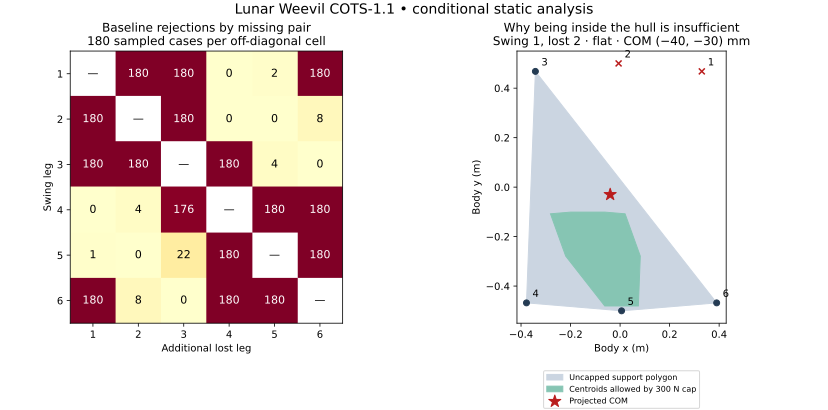

# Support-loss investigation 01

**No tested variant satisfies the complete sampled static contingency requirement.** The baseline failure is primarily a support-location and normal-load-distribution problem. The frozen load, torque, friction and stability limits remain unchanged. Hardware motion, fabrication, automatic recovery and claims of dynamic recovery remain prohibited.

This is an offline comparison for the **60 kg Earth prototype**, not measured lunar-soil performance. Nothing in this investigation changes the CAD, mechanical interfaces, original checker, or tranche 02/03 results.

## Frozen inputs and decision rule

The baseline is PR #3 head `405a49bb77b49e8f44e21c55a213462c6a513482`, including the COTS-1.1 COM height of 310 mm. [spec.json](spec.json) was committed before candidate scoring in GitHub commit `d04c1f6dbdd2024e1c8351a43a4106353ecd5b54`. SHA-256 hashes bind the original model, guard, configuration, BOM and earlier experiment specifications/results.

The fixed registry contains **12 candidate configurations**, the original reference and a zero-stride negative control. There was no adaptive expansion or parameter fitting after results. All candidates use the same four COM corners (±40 mm x, ±30 mm y), flat gravity plus eight headings at 5°, six phases and five positions per phase. Each fully executed configuration contains 1,080 nominal and 5,400 additional-foot-loss cases. Comparisons match **physical swing leg, sample, lost leg, COM corner and gravity**, so reordering a phase does not change the identity of its comparison scenario.

Admission requires every nominal and additional-loss case to pass, with complete coverage, valid joint targets, foot-pad clearance, sampled joint speed and phase continuity. The original 1.3 load factor, 300 N normal cap, 43.2 Nm torque limit, assumed friction coefficient 0.5, 40 mm support margin and 70 mm usable COP radius are retained. The six-leg and stance-translation continuity checks apply to the whole periodic gait. A lower rejection count is descriptive improvement only. Any new nominal rejection remains disqualifying.

The existing 400 mm shaft-load-arm envelope is also retained. A separate audit identified variants that exceed it; their static sensitivity results remain visible, but they are **engineering-ineligible**. This inherited-limit audit and the analytical explanation below were performed after registration. They do not alter the candidate rules, erase failures, or constitute independent holdouts.

## Why all phases fail

The reference replay reproduces **all 1,080 nominal passes and exactly 2,925 contingency rejections**, including the original per-phase counts. The rejection count is not a failure probability.

Two independent diagnostic encodings explain those 2,925 infeasible allocations:

- **1,076:** even unrestricted nonnegative contact forces cannot balance the wrench at the remaining support positions. The gravity-projected COM is outside their ordinary support polygon.
- **1,849:** equilibrium and the 300 N per-foot normal cap are already incompatible. Torque and friction restrictions are not needed to prove these particular contradictions.

There are also **1,696 concurrent 40 mm support-margin violations**, included within the 2,925 failures, not added to them. The frozen guard returns early on solver failure; the new diagnostics always retain the geometric margin and its limiting support edge.

The force-only diagnostic LP uses a separate mathematical encoding from the original peak-utilization LP and checks every successful force witness. Both use SciPy/HiGHS and share the frozen kinematics and mass assumptions; this is not a wholly independent physical model or solver backend. A separate geometric calculation enumerates the feasible normal-load centroids under the cap and supplies an additional numerical necessary-condition certificate for every baseline contingency case.

Diagnostic constraint deletion is used **only to explain rejection**. Equilibrium and unilateral support remain mandatory. The recorded group set is deletion-minimal in a fixed order, not necessarily unique or minimum-cardinality. No deleted constraint enters candidate acceptance.

### Which missing supports matter

Leg numbering is explicit: 1/2/3 are front/middle/rear on the positive-y side; 6/5/4 are front/middle/rear on the negative-y side. Body positive x denotes front. The actual phase order is 1, 4, 2, 5, 3, 6.

Removing two legs on the same side leaves one foot to carry that side's required reaction: **all 2,160 such reference cases fail**. The front-pair and rear-pair removals account for another **716** failures; the other pairs account for **49**. The middle-leg swing phases have two severe same-side pairings, while the corner-leg phases also encounter a severe front/rear pairing. This explains most of the phase-count variation.



The right panel illustrates why the ordinary polygon is insufficient: the COM can be inside the grey support hull while outside the smaller region of centroids achievable with every foot at or below 300 N. The 40 mm stability reserve remains a separate gate.

| Phase | Swing leg | Rejected / 900 |
|---|---:|---:|
| 0 | 1 | 542 |
| 1 | 4 | 540 |
| 2 | 2 | 368 |
| 3 | 5 | 383 |
| 4 | 3 | 544 |
| 5 | 6 | 548 |


### A bound that closes this candidate family

Select swing leg 1, loss of leg 2, the positive-y COM corner, and the +y 5° gravity case. Leg 3 is the only positive-y support. For radial reach r and common lateral foot translation d, let a = 0.26 + (√3/2)r. Leg 3 lies at y = a + d and all three opposite-side supports lie at y ≤ −a + d. Force and moment balance imply:

$$N_3 \geq W\frac{Y+a-d}{2a},\qquad W=60(1.3)(9.80665)\cos 5^\circ,$$

$$Y=0.03+(0.31-0.055)\tan 5^\circ.$$

Even granting the most favorable common translation d = 80 mm and the smallest allowed reach r = 200 mm, this requires **N₃ ≥ 356.65 N**, exceeding the unchanged 300 N cap. Longitudinal stride, longitudinal spread and phase ordering cannot repair this y-moment contradiction. The actual registered paths usually require more force. [family_bound.json](family_bound.json) records the premises and each variant's bound.

**CLOSED PROOFLIKE under these explicitly bounded, common-sway family premises.** This is an analytical explanation developed from the baseline diagnosis, not a preregistered holdout result. It does not rule out an arbitrary support redesign. It does rule out success through further tuning within this family without violating a premise or limit.

## Controlled comparisons

Every table entry retains its complete configuration in [results.json](results.json). “Rescued” and “regressed” compare the same physical scenario with the baseline. Counts do not establish significance, measured reliability or dynamic performance. The full paired ledger is [cases.csv.gz](cases.csv.gz), and [poses.json](poses.json) contains exact foot positions.

| Configuration | Nominal rejected / 1,080 | Loss rejected / 5,400 | Rescued | Regressed | Shaft arm (mm) | 400 mm bound |
|---|---:|---:|---:|---:|---:|---|
| baseline | 0 | 2925 | — | — | 394.58 | pass |
| reach_200mm | 0 | 2955 | 6 | 36 | 366.99 | pass |
| reach_220mm | 0 | 2938 | 1 | 14 | 380.48 | pass |
| reach_260mm | 0 | 2917 | 11 | 3 | 409.22 | **FAIL** |
| reach_280mm | 0 | 2907 | 22 | 4 | 424.35 | **FAIL** |
| stride_30mm | 0 | 2903 | 26 | 4 | 388.50 | pass |
| reverse_order | 0 | 2925 | 39 | 39 | 394.58 | pass |
| perimeter_order | 0 | 2924 | 20 | 19 | 394.58 | pass |
| alternating_order | 0 | 2940 | 36 | 51 | 394.58 | pass |
| longitudinal_spread_30mm | 0 | 2900 | 29 | 4 | 408.27 | **FAIL** |
| reach_220_stride_30mm | 0 | 2920 | 10 | 5 | 374.59 | pass |
| sway_40mm | 0 | 2877 | 65 | 17 | 412.86 | **FAIL** |
| sway_80mm | 0 | 2776 | 230 | 81 | 440.49 | **FAIL** |
| zero_stride_control | 0 | 2880 | 49 | 4 | 382.97 | pass |


**90,720 static cases executed; 0 registered static cases unexecuted.** Across the executed variants, 0 phase contingency gates pass. All nominal cases pass. The best progressing candidate that also preserves the existing shaft-arm envelope is the **30 mm stride: 2,903 rejections**, 26 rescued cases and four regressions. The larger 80 mm sway reaches 2,776 rejections, but introduces 81 regressions and reaches a 440.49 mm shaft load arm, exceeding the existing 400 mm bound. It is not an eligible improvement or a complete static pass.


All breakdowns by phase, lost leg, swing/lost pair, sample position, COM corner, gravity direction, rejection reason and diagnostic conflict are retained. For baseline gravity cases, rejections range from 320/600 on flat terrain to 338/600 at the 180° heading. The four COM-corner totals are 735, 735, 728 and 727 out of 1,350 each; position totals are 586, 586, 584, 583 and 586 out of 1,080 each. These smaller variations do not outweigh the missing-support geometry.

## Successful, unsuccessful and unexecuted work

**Successful software/analytical checks:** exact reference reproduction; independent LP agreement; valid force witnesses; complete paired scenario coverage; planted geometry, insufficient-normal-cap, zero-friction and near-zero-torque controls; unchanged engineering settings; geometric certificates and the family bound. These successes validate the bounded investigation, not a rover recovery capability.

**Unsuccessful candidates:** no candidate passes complete static contingency admission. Counts and individual regressions are retained even where the total improves. All zero-stride control failures remain visible; a non-progressing gait is not a proposed solution.

**Registered experiments left unexecuted:** none. All 12 candidates, the reference and the zero-stride control passed the preliminary kinematic screen and received their full static comparison. The shaft-arm audit independently disqualifies five candidate configurations; no load-arm limit was increased to admit them.

**Not executed:** new CAD/interface work, physical tests, dynamic or impact recovery, continuous static certification, higher-resolution force sweeps, and candidate families outside the registered bounds. No physical evidence has been invented. Existing unresolved interface and measurement blockers remain open.

## Reproduce and inspect

From `weevil-lunar/`, with the repository analysis and development requirements installed:

```sh
python verification/cots/run_support_loss_01.py --output /tmp/support-loss-01
python verification/cots/explain_support_loss.py --results-dir /tmp/support-loss-01
python verification/cots/check_support_family_bound.py --output /tmp/support-loss-01/family_bound.json
python verification/cots/check_support_loss_artifacts.py --results-dir /tmp/support-loss-01 --compare-committed
python -m pytest verification/tests/test_support_loss_analysis.py -q
```

Use a new output directory. Existing results are refused, and interrupted runs retain a checkpoint marked `complete: false`. A malformed case, incomplete registry, frozen-input mismatch, invalid witness, solver indeterminacy or encoding disagreement fails closed. The runner exiting successfully means the declared experiment executed correctly; it does not mean a candidate was admitted. See the explicit verdict and release flags in each output.

The raw CSV identifies scenarios using zero-based swing/lost indices (−1 means nominal); the human-readable leg columns are one-based. Its `reasons` can contain concurrent failures and must not be summed as disjoint categories. Geometry/COM/gravity are recoverable from the stored configuration, pose and scenario key. Gzip files are deterministic (`mtime=0`). Results bind source and artifact hashes and record the runtime versions. Reproduction compares exact decisions/counts and numeric values with explicit tolerances, not compressed-byte equality across solver builds.

Local validation: **162 unit tests passed**, including 20 support-loss regression tests; **two backend tests passed, two optional backend tests skipped**; Ruff and mypy passed. All 15 existing verification scripts and the strict/traceability gates passed. The case ledger and all 5,400 baseline planar certificates passed the artifact integrity checker. A separate GitHub Actions workflow reproduces the analysis for this draft; remote CI status must be read separately and is not asserted here.

The workflow is a research/regression gate only. It never modifies the monitor or enables hardware. The next warranted design input is a mechanically justified support arrangement that can satisfy capped force-and-moment balance before further detailed search. This investigation supplies no fabrication authorization and no claim of transient recovery.
